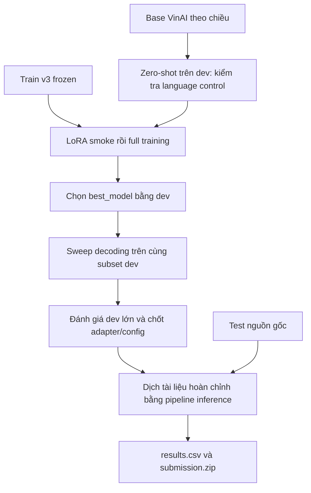

# Tutorial cho thành viên: hiểu phương pháp và tinh chỉnh VinAI trên Kaggle

Tài liệu đối chiếu với code, config và notebook của repo ngày **06/10/2026**.
Đọc phần 1–3 để hiểu hệ thống; thực hiện phần 4–7 để chạy thí nghiệm mới. Phần
8–10 hướng dẫn dùng model đã train, lưu kết quả và xử lý lỗi thường gặp.

## Mục lục

1. [Bài toán, phương pháp và trạng thái hiện tại](#1-bài-toán-phương-pháp-và-trạng-thái-hiện-tại)
2. [Dữ liệu và nguyên tắc đánh giá](#2-dữ-liệu-và-nguyên-tắc-đánh-giá)
3. [Các file cần biết](#3-các-file-cần-biết)
4. [Chuẩn bị local và Input Kaggle](#4-chuẩn-bị-local-và-input-kaggle)
5. [Chạy một thí nghiệm LoRA mới trên Kaggle](#5-chạy-một-thí-nghiệm-lora-mới-trên-kaggle)
6. [Tinh chỉnh tham số có kiểm soát](#6-tinh-chỉnh-tham-số-có-kiểm-soát)
7. [Chọn decoding và đọc kết quả](#7-chọn-decoding-và-đọc-kết-quả)
8. [Resume, adapter cũ và cải tiến inference](#8-resume-adapter-cũ-và-cải-tiến-inference)
9. [Tạo submission và bàn giao cho nhóm](#9-tạo-submission-và-bàn-giao-cho-nhóm)
10. [Lỗi thường gặp và checklist hoàn thành](#10-lỗi-thường-gặp-và-checklist-hoàn-thành)

## 1. Bài toán, phương pháp và trạng thái hiện tại

### 1.1 Hệ thống cần làm gì?

Hệ thống dịch **toàn bộ tài liệu pháp luật**, theo hai chiều tiếng Anh → tiếng
Việt và tiếng Việt → tiếng Anh. Bản dịch cần đúng nội dung, quyền/nghĩa vụ, điều
kiện/ngoại lệ, thuật ngữ, số liệu, viện dẫn và cấu trúc Markdown. Dịch trôi chảy
chưa đủ nếu bỏ một khoản hoặc đổi số điều.

Repo dùng tên chiều `en2vi` / `vi2en` trong training và config. Trong CSV nộp,
tên chiều bắt buộc là `en-vi` / `vi-en`. Đừng đổi trực tiếp tên chiều trong JSON
training thành tên chiều của CSV.

### 1.2 Base model và seq2seq

Mỗi chiều có **một VinAI Translate v2 riêng**, thuộc họ mBART encoder–decoder.
Encoder đọc nguồn; decoder sinh bản dịch từng token, có điều kiện trên nguồn và
các token đích trước đó. Hai chiều có tokenizer/language control tương ứng; không
chỉ đảo cột dữ liệu rồi dùng cùng một model cho cả hai chiều.

| Chiều | Base model | Revision cố định |
|---|---|---|
| EN→VI | `vinai/vinai-translate-en2vi-v2` | `1e47495b5dac16097b1d9e7b4133c27e1f40504f` |
| VI→EN | `vinai/vinai-translate-vi2en-v2` | `4eb2219d447d4352861e71e371a6b6abcb0509c8` |

`src/vinai_baseline/language.py` đặt ngôn ngữ nguồn/đích và decoder start token.
Giữ bản sửa này khi đóng gói; loss giảm không bảo đảm model sinh đúng ngôn ngữ
nếu language control bị đặt sai.

### 1.3 Fine-tuning bằng LoRA

Model gốc đã biết dịch tổng quát. Nhóm thích nghi nó với văn bản pháp luật bằng
các cặp train EN–VI, dùng **LoRA** ở `q_proj` và `v_proj` của attention:

\[
W' = W + \frac{\alpha}{r}BA.
\]

`W` là trọng số gốc được giữ cố định; `A`, `B` là hai ma trận nhỏ được học thêm.
`r` là hạng của phần cập nhật, `alpha/r` là hệ số khuếch đại. Cấu hình hiện tại
`r=16`, `alpha=32`, dropout `0.05`, train khoảng `0,55%` tham số. Adapter nhỏ hơn
base weights nhưng khi dịch vẫn cần **base đúng revision + adapter đúng chiều**.

Trong training, decoder học dự đoán token đích từ reference và nguồn. Sau mỗi
epoch, code sinh bản dịch trên dev để đo chất lượng. Mô hình có loss nhỏ nhất
không nhất thiết có bản dịch tốt nhất; baseline chọn checkpoint theo chrF++.

Phân biệt các chế độ:

| `MODE` trong notebook 03 | Ý nghĩa | Có cập nhật trọng số? |
|---|---|---|
| `zero_shot` | Đánh giá base gốc; JSON có `training.mode="none"` | Không |
| `lora` | Học adapter trên train pháp lý | Có, chỉ phần LoRA |
| `full` | Fine-tune toàn bộ model | Có, tốn tài nguyên hơn LoRA |

Thành viên mới nên bắt đầu bằng `lora`. `full` không có nghĩa là chạy đủ dữ liệu;
chạy đầy đủ một thí nghiệm LoRA dùng `MODE="lora"` và bật full run ở phần 9.

### 1.4 Training, decoding và inference là ba thay đổi khác nhau



**Training** thay trọng số. **Decoding sweep** dùng cùng trọng số nhưng đổi cách
tìm bản dịch: số beam, length penalty, repetition penalty và no-repeat ngram.
**Inference pipeline** quyết định chia/ghép tài liệu, giữ Markdown và kiểm tra
output. Có thể sửa decoding/inference mà không train lại.

### 1.5 Những gì đã làm và những gì còn cần đo

| Thành phần | Trạng thái |
|---|---|
| Dataset v3 | Đã semantic audit và freeze, dùng chung trong nhóm |
| Hai LoRA và decoding baseline | Đã train và chạy sweep; artifact ở `modelAI/`, `results_model_sweep_testset/` |
| Bài nộp baseline toàn tài liệu | Đã có kết quả do trưởng nhóm cung cấp, xem bảng dưới |
| VI→EN context v2 | Đã có code, test cấu trúc và smoke model thật; cần đo chất lượng đầy đủ trên GPU |
| Glossary/terminology memory | Glossary hiện chưa có entry `approved`; chưa bật trong luồng results submission |
| Pipeline pháp lý mở rộng notebook 05 | Có code, còn cần A/B và nghiệm thu; chưa mặc định dùng trong submission |

Context v2 ghép các dòng văn xuôi bị xuống dòng trình bày trước khi dịch VI→EN.
Ví dụ `... chức năng, nhiệm vụ, quyền hạn` và dòng tiếp `và cơ cấu tổ chức ...`
được đọc như một câu. Heading, list, table và inline Markdown vẫn được bảo vệ.
Các span quanh inline Markdown còn dùng đường xử lý thận trọng; **chưa có bước
căn chỉnh toàn câu để phục hồi inline markup**, và chưa tự ép thuật ngữ.

Preflight cấu trúc trên 50 nguồn VI→EN gom 29.004 source units thành 14.569 nhóm
logic. Đây là bằng chứng chia/ghép chạy được, không phải bằng chứng BLEU tăng.

Điểm baseline toàn tài liệu do trưởng nhóm cung cấp:

| Nguồn điểm | BLEU | chrF |
|---|---:|---:|
| Local EN→VI, 50 tài liệu | 63.8944 | 80.9574 |
| Local VI→EN, 50 tài liệu | 41.1422 | 77.7356 |
| Local macro hai chiều | 52.5183 | 79.3465 |
| Leaderboard baseline | 52.8118 | 79.5808 |

VI→EN là hướng nhóm đang ưu tiên. Chênh lệch BLEU/chrF chỉ gợi ý cần kiểm tra
cụm từ và ngữ cảnh; phải đọc prediction mới xác định được lỗi cụ thể.

## 2. Dữ liệu và nguyên tắc đánh giá

### 2.1 Vì sao chia theo tài liệu?

Nếu chia ngẫu nhiên từng đoạn, các đoạn gần nhau trong một văn bản có thể rơi
vào cả train và dev. Model đã gặp nội dung tương tự khi train nên điểm dev dễ
bị lạc quan. Repo gom **duplicate group của document**, rồi chia theo nhóm;
stratify theo category, dev ratio `0.10`, split seed `67`.

Pipeline chuẩn bị đã align hai ngôn ngữ, chia/pack theo token và loại các cặp lỗi
hoặc trùng. LaBSE chấm độ tương đồng ngữ nghĩa, sau đó dataset cuối giữ các cặp
có alignment score `>=0.75` và semantic similarity `>=0.70`.
LaBSE có giới hạn audit 256 tokens; train VinAI có giới hạn riêng. Hai giới hạn
này không phải một.

### 2.2 Dataset chuẩn của nhóm

Thư mục `artifacts/processed_clean_semantic_seed67_v3/` có:

| Split | Số cặp/chiều | Dùng để làm gì? |
|---|---:|---|
| Train | 27.756 | Cập nhật trọng số trong training |
| Dev | 2.783 | Chọn checkpoint, hyperparameter, decoding và kiểm tra lỗi |
| Public segment đã lọc | 1.837 | Báo cáo thực nghiệm segment lịch sử |

`manifest.json` phải có `dataset_id="legal_envi_clean_semantic_seed67_v3"` và
`semantic_audit_only=false`. `semantic_audit_seed67_v3` mới chỉ là audit; không
dùng thay cho dataset frozen để train. Thành viên tinh chỉnh cùng benchmark
không cần chạy LaBSE, notebook 04 hoặc tạo lại split.

Public test gốc có **50 cặp document** tại `data/test/en-vi-public_test.csv`.
Bài nộp dùng nguồn gốc đầy đủ, tạo 100 prediction: cả hai chiều của mỗi ID.
Các segment v3 đã loại một phần nội dung test, nên không ghép 1.837 prediction
segment để tạo bài nộp đầy đủ. Private gồm 100 tài liệu, mỗi tài liệu có một
direction do ban tổ chức cung cấp.

### 2.3 Ba tập đánh giá và hai loại chrF

| Mức đánh giá | Dữ liệu | Metric/phạm vi |
|---|---|---|
| Checkpoint/preflight/sweep nhanh | 256 dev records cố định | BLEU, chrF++, quality gate |
| Final generation của full training | Dev retained sau token audit | Kiểm `evaluated_records`; kỳ vọng 2.783 với cấu hình frozen hiện tại |
| Phần 12 của notebook 03 | Subset 1.821 dev records | Đánh giá candidate đã chọn; **chưa phải toàn bộ dev** |
| Notebook 06 | 50 tài liệu nguồn gốc mỗi chiều | Corpus BLEU, chrF, macro hai chiều và kiểm ZIP |

Trong training, key JSON `chrf` đang là **chrF++**, có `word_order=2`.
Trong chấm bài nộp, **chrF** có character order `6`, beta `2`, word order `0`;
BLEU dùng tokenizer `13a` và exponential smoothing. Tính riêng hai chiều rồi
lấy trung bình cộng, không gộp cả hai chiều thành một corpus để chấm.

Để so thí nghiệm, dùng cùng tập record, tokenizer/metric protocol, model revision
và dataset hash. Không so trực tiếp chrF++ trên segment với chrF trên document.
Không lấy public/private reference để đưa vào training hoặc tạo glossary.
Nhóm dùng **dev để chọn phương pháp**; điểm test/leaderboard là báo cáo cuối.

## 3. Các file cần biết

### 3.1 Code và notebook được version trong Git

| File/thư mục | Vai trò | Khi nào cần đọc/sửa? |
|---|---|---|
| [03_vinai_kaggle.ipynb](../notebooks/03_vinai_kaggle.ipynb) | Audit, zero-shot gate, smoke, train, verify, sweep | Notebook chính để fine-tune |
| [04_v3_builder_kaggle.ipynb](../notebooks/04_v3_builder_kaggle.ipynb) | Audit/freeze dataset | Khi làm phiên bản dữ liệu mới, không cần cho tuning cùng v3 |
| [05_inference_pipeline_kaggle.ipynb](../notebooks/05_inference_pipeline_kaggle.ipynb) | Đánh giá pipeline pháp lý trên dev | Cải tiến inference/glossary/retry |
| [06_results_submission_kaggle.ipynb](../notebooks/06_results_submission_kaggle.ipynb) | Dịch nguồn test gốc, ghi CSV/ZIP | Sau khi chốt hệ thống |
| [configs/generated_v3](../configs/generated_v3) | Sáu config chuẩn: 3 mode × 2 chiều | Copy để tạo config thí nghiệm riêng |
| [config.py](../src/vinai_baseline/config.py) | Schema và validation config | Kiểm tên field được hỗ trợ |
| [modeling.py](../src/vinai_baseline/modeling.py) | Base offline, LoRA và báo cáo tham số | Đổi cấu hình adapter/model loader |
| [language.py](../src/vinai_baseline/language.py) | Language control | Khi chẩn đoán sai ngôn ngữ |
| [data.py](../src/vinai_baseline/data.py) | Đọc JSONL, token audit, collator | Khi chẩn đoán data/label/collation |
| [runner.py](../src/vinai_baseline/runner.py) | Training, checkpoint, resume, save/reload | Khi cần thay thuật toán training |
| [metrics.py](../src/vinai_baseline/metrics.py), [quality.py](../src/vinai_baseline/quality.py) | Metric và quality gate | Giải thích điểm/gate |
| [sweep_cli.py](../src/vinai_baseline/sweep_cli.py) | Sweep decoding trên dev cố định | Thí nghiệm không cập nhật trọng số |
| [results_submission.py](../src/vinai_baseline/results_submission.py) | Dịch document, context v2, CSV/ZIP | Cải tiến chia/ghép và xuất bài nộp |
| [submission/configs](../submission/configs) | Config inference cuối và pipeline flag | Sau khi nhóm duyệt phương pháp |
| [submission/resources](../submission/resources) | Glossary và candidate cần duyệt | Bổ sung thuật ngữ từ nguồn hợp lệ |
| [tests](../tests) | Kiểm tra các contract và luồng xử lý | Khi sửa code, chạy test tương ứng |

Chỉ đổi learning rate/epoch/batch/rank thì thường **không cần sửa runner.py**;
tạo JSON riêng trước. Giữ notebook gốc làm tham chiếu và lưu notebook thí nghiệm
của thành viên trong repo khi cần tái lập.

### 3.2 Artifact phải nhận thêm từ trưởng nhóm

`.gitignore` đang bỏ qua dữ liệu gốc, frozen artifacts, offline assets, các ZIP,
model weights và phần lớn kết quả. **Clone Git không mang theo những file này.**

| Artifact | Cần cho train mới? | Cách nhận |
|---|---|---|
| Dataset v3 frozen + config chuẩn trong ZIP project training | Có | Nhận ZIP từ trưởng nhóm hoặc nhận artifact rồi tự package |
| Base VinAI đúng chiều | Có | Dùng chung Kaggle Input đã upload hoặc nhận offline model ZIP |
| Wheelhouse Linux đúng Python | Có khi Internet OFF | Dùng chung Kaggle Input hoặc nhận ZIP offline |
| ZIP result chứa `best_model` | Không | Cần khi đánh giá/sweep adapter có sẵn |
| Run chưa xong có `checkpoints/checkpoint-*` | Chỉ khi resume | Cần cả state, optimizer và resolved config |
| CSV public gốc | Không cho train | Cần cho notebook 06, khác public JSONL đã lọc |

Không thêm weights/data vào Git để giải quyết thiếu file. Nhóm cần chia sẻ cả
**code commit + artifact phiên bản xác định** và cấp quyền Kaggle Dataset cho
thành viên; Dataset private không tự có quyền truy cập chỉ vì cùng repo Git.

## 4. Chuẩn bị local và Input Kaggle

### 4.1 Tạo gói training trên Windows

Nếu đã nhận ZIP training mới từ trưởng nhóm thì bỏ qua bước package. Nếu tự làm,
kiểm tra đã có thư mục frozen tại đúng đường dẫn trước; một ZIP frozen còn nằm
trong Downloads chưa đủ, cần giải nén để `manifest.json` nằm trong thư mục đó.

Chạy PowerShell từ gốc repo:

```powershell
Set-Location D:\MyProject\NLP
Test-Path artifacts\processed_clean_semantic_seed67_v3\manifest.json
New-Item -ItemType Directory -Path dist -Force | Out-Null
powershell -ExecutionPolicy Bypass -File scripts/package_colab.ps1 `
  -DatasetPath artifacts\processed_clean_semantic_seed67_v3 `
  -OutputPath dist\NLP_v3_frozen_team_20261006.zip
Get-FileHash dist\NLP_v3_frozen_team_20261006.zip -Algorithm SHA256
```

Thay `D:\MyProject\NLP` bằng đường dẫn máy mình. `Test-Path` phải trả `True`.
Script tên `package_colab.ps1` nhưng ZIP dùng được trên **Kaggle**, đóng gói code,
requirements, configs, tests, docs và dataset frozen. Script có thể ghi đè output
cùng tên: chọn tên có ngày/version mới để giữ gói đã dùng cho run cũ.

Gói `NLP_results_submission_kaggle_v4_context.zip` chỉ phục vụ inference, **không
có train/dev frozen**, nên không dùng thay cho ZIP training này.

### 4.2 Base model và wheelhouse offline

Nếu nhóm đã có các Input này, Add Input từ Dataset dùng chung, không cần tải
lại. Chỉ khi local có Internet và chưa có assets, dùng script của repo:

```powershell
python -m pip install -U huggingface_hub
python scripts/prepare_offline_training_assets.py `
  --output-dir offline_training_assets `
  --directions both `
  --python-version 313
```

Script tải model đúng revision và tạo checksum manifest. Các file nhận được:

```text
offline_training_assets/
├── vinai-translate-en2vi-v2.zip
├── vinai-translate-vi2en-v2.zip
└── vinai-training-wheelhouse-py313-linux.zip
```

Mỗi base ZIP hiện khoảng 1,69 GB; wheelhouse khoảng 129 MB trên máy nhóm.
Đây là kích thước artifact hiện có, không phải yêu cầu dung lượng cố định.

Wheelhouse hiện dành cho **Linux CPython 3.13**, không dùng Windows wheels để
cài trên Kaggle. Kiểm tra `sys.version` của runtime. Nếu Python đổi, cần chuẩn bị
wheel phù hợp và kiểm tra bản thân wheel tags; tên ZIP trong script hiện vẫn ghi
`py313` ngay cả khi đổi `--python-version`, nên đừng chỉ dựa vào tên file.

Stack Kaggle được khóa ở `requirements-training-colab.txt`: Transformers
`5.17.0`, Accelerate `1.15.0`, PEFT `0.21.0`, SacreBLEU `2.6.0`, SentencePiece
`0.2.2`, Protobuf `6.33.6`. PyTorch/CUDA do runtime Kaggle cung cấp; notebook
kiểm tra phiên bản và ghi runtime vào manifest.

### 4.3 Bốn Input cần attach

| Input | Train VI→EN | Train EN→VI |
|---|---|---|
| ZIP training project vừa package | Bắt buộc | Bắt buộc |
| `vinai-translate-vi2en-v2` ZIP/thư mục | Bắt buộc | Tùy chọn |
| `vinai-translate-en2vi-v2` ZIP/thư mục | Tùy chọn | Bắt buộc |
| `vinai-training-wheelhouse-py313-linux` | Bắt buộc khi offline | Bắt buộc khi offline |

Chạy cả hai chiều thì attach cả hai base model. LoRA run mới **không cần** ZIP
model đã train trước, LaBSE hoặc semantic audit ZIP.

Tạo Kaggle Dataset/Input cho artifact và thêm vào notebook bằng **Add Input**.
Kaggle có thể tự giải nén ZIP; notebook 03 hỗ trợ cả ZIP và folder. Input tại
`/kaggle/input` chỉ đọc; notebook copy project sang `/kaggle/working` để ghi config,
logs và output. Nếu có nhiều project, chọn đúng bằng `INPUT_NAME_HINT` ở phần 2.

## 5. Chạy một thí nghiệm LoRA mới trên Kaggle

### 5.1 Khởi tạo session

Import [notebook 03](../notebooks/03_vinai_kaggle.ipynb), bật GPU, Internet OFF và
Add đủ Inputs. Chạy tuần tự phần **1 → 5**:

| Phần notebook | Điều cần xác nhận |
|---|---|
| 1. GPU | CUDA available `True`; tên GPU đúng |
| 2. Project Input | `PROJECT_DIR` trỏ project trong working; không nhầm project inference |
| 3. Dependencies | `Offline dependencies: PASSED` |
| 4. Model | `LOCAL_MODEL_DIRS['vi2en']` hoặc `['en2vi']` có đường dẫn thật |
| 5. Dataset | `Frozen v3: PASSED`, counts train 27.756, dev 2.783 mỗi chiều |

Cell GPU đặt `CUDA_VISIBLE_DEVICES="0"`: baseline dùng **một GPU**, kể cả Kaggle
hiển thị hai T4. Không nhân effective batch với hai GPU khi notebook này chỉ
nhìn thấy một. Không tự bật multi-GPU trong một phép so sánh chưa ghi rõ thay đổi.

### 5.2 Tạo config riêng trước phần 6

Với run baseline, để `CONFIG_OVERRIDE=""`. Với thí nghiệm tuning, thêm một code
cell **sau phần 5, trước phần 6**. Ví dụ thành viên Linh thử learning rate `3e-5`:

```python
import json
from src.vinai_baseline.config import ExperimentConfig

member = "linh"
direction = "vi2en"
tag = "lr3e5"
source_config = PROJECT_DIR / f"configs/generated_v3/{direction}_lora.json"
payload = json.loads(source_config.read_text(encoding="utf-8"))
payload["run_name"] = f"{member}_{direction}_lora_{tag}"
payload["training"]["learning_rate"] = 3e-5

relative_config = f"configs/team/{direction}_lora_{member}_{tag}.json"
member_config = PROJECT_DIR / relative_config
member_config.parent.mkdir(parents=True, exist_ok=True)
if member_config.exists():
    raise FileExistsError(f"Config đã có: {member_config}; dùng tag mới hoặc đọc lại file hiện có")
member_config.write_text(json.dumps(payload, ensure_ascii=False, indent=2), encoding="utf-8")
ExperimentConfig.from_json(member_config)  # kiểm field và giá trị trước khi chạy
print("CONFIG_OVERRIDE =", relative_config)
```

Ví dụ này là **cách tạo thí nghiệm**, chưa phải learning rate đã được chứng minh
tốt hơn baseline. Không sửa `configs/generated_v3/vi2en_lora.json` để mọi run cùng
tên nhưng khác nội dung. File mới ở working chưa có trong Git: tải nó về lúc bàn giao.

### 5.3 Điền cell phần 6

Trong cell hiện có của phần 6, sửa các biến đầu; giữ phần validation bên dưới:

```python
DATASET_PROFILE = "v3_frozen"
DIRECTION = "vi2en"
MODE = "lora"
CONFIG_OVERRIDE = "configs/team/vi2en_lora_linh_lr3e5.json"
RUN_FULL = False
MEMBER_TAG = "linh"
EXPERIMENT_TAG = "lr3e5"
RUN_ID_OVERRIDE = ""
RESUME_FROM_CHECKPOINT = ""
RESUME_RUN_SOURCE = ""
```

`MEMBER_TAG`/`EXPERIMENT_TAG` chỉ dùng chữ thường không dấu, số, `_` và `-`.
`RUN_ID` chứa dataset, chiều, mode, seed, thành viên, tag và timestamp.
Mỗi thí nghiệm mới có RUN_ID mới. Notebook giữ split seed và training seed `67`;
đừng đổi seed trong config rồi coi đó là run được notebook hỗ trợ bình thường.

### 5.4 Audit và zero-shot gate

Chạy phần **7**, rồi **7b**. Audit kiểm tra data/token/collator; zero-shot dịch
256 dev records cố định bằng base gốc, không cập nhật trọng số.
Thành công khi in `Zero-shot gate PASSED`.

Report gắn với chiều, dữ liệu, model revision, decoding và code. Khi đổi một
trong các thành phần này phải tạo diagnostic mới; không dùng report EN→VI cho
VI→EN. Gate cảnh báo output ngắn vẫn có thể pass; output rỗng, lặp/collapse, quá
dài hoặc sai ngôn ngữ nghiêm trọng có thể làm hard gate fail. Không sửa
`quality.status` hoặc bỏ `require_preflight()` để vượt gate.

### 5.5 Smoke trước, full sau

Với train mới, giữ hai cờ ở phần **7c** là `False`, rồi chạy phần **8**. LoRA
smoke dùng 32 mẫu train và 16 dev, kiểm forward/backward, save, reload và generation.
Smoke pass không phải bằng chứng model đủ tốt.

Sau smoke pass, **không chạy lại cell phần 6**, vì nó sẽ sinh RUN_ID mới và làm
mất liên kết với smoke cũ. Ở cell phần **9. Full run**, đặt:

```python
START_FULL_NOW = True
```

Chỉ chạy lại cell phần 9. Config mặc định train tối đa 3 epoch, checkpoint/eval
theo epoch, chọn best bằng chrF++ trên 256 dev records, rồi sinh prediction trên
dev retained. Early stopping có thể kết thúc sớm. Log final generation vẫn chạy
sau khi các epoch đã xong; chưa thấy report cuối thì chưa coi toàn run hoàn tất.

### 5.6 Lưu artifact trước khi session mất

Chạy phần **10** để xem metric, kiểm prediction count và tải `<RUN_ID>_result.zip`.
Phải phân biệt nó với `<RUN_ID>_smoke_result.zip`. Run layout:

```text
<RUN_ID>/
├── best_model/                 # adapter/model đã chọn và tokenizer
├── checkpoints/checkpoint-*/   # checkpoint có state để resume
├── reports/
│   ├── validation_metrics.json
│   ├── quality_gate.json
│   └── reload_smoke.json
├── predictions/validation_predictions.jsonl
├── logs/
├── resolved_config.json
└── run_manifest.json
```

Run chưa hoàn thành có thể chưa có các file cuối. Dùng **Save Version có Output**
và tải ZIP/backup run trước khi tắt session; `/kaggle/working` không phải kho lưu
trữ bền vững. Chưa tải checkpoint thì không có state để resume sau khi session mất.

## 6. Tinh chỉnh tham số có kiểm soát

### 6.1 Baseline để bắt đầu

Các giá trị dưới đây lấy từ `configs/generated_v3/vi2en_lora.json`; EN→VI có
cùng profile training chính. Không lấy config inference trong `submission/configs`
làm config training vì mục đích và đường dẫn data của nó khác.

| Tham số | Baseline | Ý nghĩa |
|---|---:|---|
| `training.epochs` | 3 | Số lượt qua train, có thể dừng sớm |
| `training.learning_rate` | `5e-5` | Kích thước bước cập nhật adapter |
| `training.weight_decay` | `0.01` | Regularization |
| `training.warmup_ratio` | `0.05` | Tăng LR dần ở đầu train |
| `training.label_smoothing` | `0.1` | Giảm ép xác suất tuyệt đối vào một token đích |
| `training.per_device_train_batch_size` | 4 | Số mẫu mỗi micro batch trên một GPU |
| `training.gradient_accumulation_steps` | 4 | Gom gradient qua 4 micro batch |
| `training.per_device_eval_batch_size` | 16 | Batch sinh/chấm dev trong runner |
| `training.gradient_checkpointing` | `true` | Giảm VRAM bằng tính lại activation |
| `training.fp16` | `true` | Precision của training |
| `training.checkpoint_eval_samples` | 256 | Dev subset cho chọn checkpoint |
| `training.checkpoint_max_per_document` | 6 | Hạn chế một document lấn át subset |
| `training.metric_for_best_model` | `chrf` | chrF++ trong training hiện tại |
| `lora.rank`, `lora.alpha` | 16, 32 | Kích thước và scaling adapter |
| `lora.dropout` | `0.05` | Regularization của nhánh LoRA |

Effective batch hiện tại là `4 × 4 × 1 GPU = 16`. Nếu OOM, thử micro batch `2`,
accumulation `8` để vẫn giữ effective batch 16; eval batch giảm riêng, ví dụ `8`.
Các giá trị này cần thử bằng smoke trên GPU thật, không bảo đảm mọi máy đều đủ VRAM.

Data input/label giới hạn 512 tokens, `overlength_policy="error"`. `generation`
mặc định dùng beam `2`, `max_new_tokens=448`, length/repetition penalty `1.0`,
no-repeat ngram `3`. Nếu đổi `max_new_tokens` sang `None`, generation dùng
`max_length`; không gọi 448 là giới hạn token input của training.

### 6.2 Một kế hoạch thí nghiệm dễ so sánh

| Run đề xuất | Đổi so với baseline | Mục tiêu kiểm tra |
|---|---|---|
| `baseline` | Không đổi | Xác nhận môi trường và protocol tái lập |
| `lr3e5` | Chỉ LR `3e-5` | Bước nhỏ hơn có giữ generalization tốt hơn không? |
| `lr7e5` | Chỉ LR `7e-5` | Adapter có học miền nhanh hơn nhưng overfit không? |
| `rank32_alpha64` | Rank 32, alpha 64 | Tăng khả năng thích nghi, giữ `alpha/r=2` |
| `dropout010` | Chỉ LoRA dropout `0.10` | Kiểm tra regularization |

Đây là **các giả thuyết thí nghiệm**, không phải cấu hình đã được chọn. Phân công
mỗi thành viên một thay đổi; giữ dataset/seed/subset/metric giống nhau. Rank và
alpha đi cùng trong ví dụ để giữ scaling; không coi đây là phép đo riêng tác động
của alpha. Không đổi LR, rank, decoding và data cùng lúc rồi quy kết điểm tăng
cho một yếu tố.

### 6.3 Cách sửa code khi muốn thử phương pháp mới

Đổi hyperparameter trước bằng JSON. Nếu cần đổi training loss, sampling hoặc
checkpoint strategy, sửa runner/data và test phù hợp; ghi rõ thay đổi protocol.
Đổi preprocessing/split/threshold là một thí nghiệm **dataset mới**, cần manifest
và dataset ID mới. Notebook 03 hiện khóa ID v3 và seed 67; muốn hỗ trợ benchmark
mới phải cập nhật validation có chủ đích, không chỉ đổi một biến profile.

## 7. Chọn decoding và đọc kết quả

### 7.1 Generation sweep không cần train lại

Sau khi adapter đã được kiểm tra, ở phần **11** bật `RUN_GENERATION_SWEEP=True`.
Notebook lấy adapter của full run hoặc adapter được nạp ở 7c. Nó thử cùng 256
dev records, giữ weights, và ghi `sweep_summary.json`/prediction riêng.
Candidate có format:

```text
name:beams:length_penalty:repetition_penalty:no_repeat_ngram_size:max_new_tokens
beam4longer:4:1.10:1.0:3:none
```

`none` ở cuối nghĩa dùng `max_length`, không phải sinh vô hạn. Beam lớn hơn
không luôn tăng điểm; no-repeat ngram cũng có thể chặn các cụm lặp hợp lệ trong
văn bản luật. Chọn candidate bằng dev metrics **và** đọc các mẫu thiếu nội dung,
sai số/viện dẫn, lặp và output cụt.

Ở phần **12**, điền `SELECTED_GENERATION_NAME` đúng tên candidate và bật
`RUN_FULL_ADAPTER_EVAL=True`. Code hiện có `--samples 1821`: nhãn cell nói
“toàn bộ 1.821 mẫu” nhưng thực tế là **subset của 2.783 dev**, không phải full dev.
Nếu nhóm cần chấm đủ dev bằng CLI này, dùng số record retained sau audit
(`2783` với profile hiện tại), output mới và kiểm `evaluated_records`.

Các tên thư mục/config kiểu `epoch2_*` trong notebook là tên lịch sử của lần
thử adapter trước; chúng không chứng minh adapter mới được chọn ở epoch 2.
Muốn biết checkpoint thật, xem Trainer state/manifest của run.

### 7.2 Training hoàn thành khác quality gate pass

| Artifact | Dùng để kết luận |
|---|---|
| `reports/validation_metrics.json` | Số record đã chấm, BLEU/chrF++, runtime |
| `reports/quality_gate.json` | Hard failures/warnings của final evaluation |
| `reports/reload_smoke.json` | Model đã save có reload được, quality sau reload |
| `predictions/validation_predictions.jsonl` | Đọc nguồn/reference/output theo segment ID |
| `resolved_config.json`, `run_manifest.json` | Tham số thật, versions, data/model identity |

`verify` có thể trả lỗi sau khi train đã save thành công vì quality gate failed.
Đừng xóa model hoặc train lại ngay. Đọc cả ba report: lỗi load weights khác với
lỗi bản dịch, và danh sách viện dẫn lặp từ “Điều” có thể gây false positive cho
dominant-token heuristic. Vẫn cần xem từng sample trước khi quyết định cách sửa.

Khi nhìn loss, xem cùng dev score và ví dụ lỗi; train loss giảm nhưng dev xấu đi
có thể là overfit. Khi final generation chậm, xem GPU/log thay vì suy ra training
bị treo chỉ vì vài phút không có loss mới.

## 8. Resume, adapter cũ và cải tiến inference

### 8.1 Resume một run đang dở

Chỉ resume run **chưa hoàn thành**, có checkpoint hợp lệ. Attach Output cũ làm
Input; giữ original RUN_ID, config, seed, dataset và hyperparameters. Phần 6:

```python
RUN_ID_OVERRIDE = "<RUN_ID_goc>"
RESUME_FROM_CHECKPOINT = "last"
RESUME_RUN_SOURCE = "/kaggle/input/<old-output>/<RUN_ID_goc>"
RUN_FULL = True
```

Thay các placeholder bằng tên thật; directory cuối phải có tên bằng RUN_ID.
Notebook copy run sang output đích rồi runner kiểm `resolved_config.json` và
`language_control.json`. Cần state/optimizer/checkpoint, không chỉ `best_model`.
Chạy audit và preflight cho run; smoke được bỏ qua khi resume. Run có
`run_manifest.json` cuối bị bảo vệ khỏi train/resume ghi đè.

**Không đổi LR/epoch/rank rồi resume để tạo thí nghiệm khác.** Repo cố ý chặn
config không khớp run cũ. “Fine-tune tiếp từ adapter đã hoàn thành với LR mới”
là warm-start thí nghiệm mới; CLI training hiện **chưa có tùy chọn đó**.
`--saved-model-dir` trong preflight/sweep chỉ nạp model để đánh giá, không train.

### 8.2 Dùng adapter cũ để chấm/sweep

Attach ZIP result có `best_model`, `resolved_config.json` và
`reports/validation_metrics.json`, hoặc attach directory đã giải nén.
Ở phần 7c đặt `LOAD_COMPLETED_ADAPTER_FOR_SWEEP=True`; nếu có nhiều adapter,
điền rõ `OLD_ADAPTER_DIR`. Đặt `RUN_OLD_ADAPTER_CHECK=True` nếu cần diagnostic
256 trước. Có thể bỏ phần train 8–10 và dùng phần 11–12.

Không tự nhận mọi ZIP report là ZIP model. ZIP sweep/dev/public predictions
không chứa `adapter_model.safetensors` thì không thể dùng để nạp adapter.

### 8.3 Làm inference/glossary mà không đổi weights

Dùng [notebook 05](../notebooks/05_inference_pipeline_kaggle.ipynb) và
[hướng dẫn pipeline pháp lý](legal_inference_pipeline.md) để kiểm A/B trên dev.
Code liên quan nằm trong `src/vinai_baseline/pipeline/`; config flag ở
`submission/configs/inference_pipeline.json`. Notebook 05 khác luồng context v2
trong `results_submission.py`; bật flag ở notebook 05 không tự thay notebook 06.

`glossary_candidates.csv` là ứng viên từ train, có cả cụm bị cắt và bản dịch
mâu thuẫn. Thành viên phải đọc nguồn, sửa `preferred`/`accepted_variants`, duyệt
và đưa entry hợp lệ vào `glossary.csv` trước. Chỉ đổi tất cả `pending` thành
`approved` không phải review. Pipeline chỉ đọc approved theo direction/domain;
**luồng results submission hiện không áp dụng glossary/terminology memory**.

Đánh giá feature bằng cùng dev và lưu từng nhánh, lỗi thực thể, structure,
runtime và review mẫu pháp lý. Không tăng điểm thuật ngữ bằng cách chèn glossary
vào cuối prediction. Xem [SPEC](SPEC_legal_translation_inference_pipeline.md)
về điều kiện nghiệm thu pipeline trước khi bật cho submission.

## 9. Tạo submission và bàn giao cho nhóm

### 9.1 Sau khi chốt model/config trên dev

Gửi trưởng nhóm adapter ZIP, config đã chọn và report dev. Hiện
`scripts/package_results_submission.py` tự chọn đúng **một ZIP/chiều** trong
`modelAI/` và dùng `submission/configs/{direction}.json`. Không đặt nhiều run
thử nghiệm cùng chiều vào đó rồi kỳ vọng script tự chọn winner. Lưu các run thử
ở thư mục riêng; nhóm chốt một model/chiều trước khi package.

Nếu thay adapter hoặc decoding cuối, cập nhật config inference theo quyết định
đã chốt trên dev và tạo Input ZIP version mới. Không dùng config submission
hiện tại rồi khẳng định đó là decoding đã chọn cho một adapter mới.

Notebook 06 cần Input project inference mới, hai base model, wheelhouse và CSV
test nguồn gốc (public đã nằm trong bundle). Nếu muốn giữ EN→VI cũ, thêm
`submission.zip` baseline vào Input; notebook chỉ tái sử dụng 50 dòng EN→VI.
Nếu chủ động thử cả model EN→VI mới thì tắt reuse bằng `REUSE_EN2VI_ZIP=None`
sau đoạn tự nhận diện, để code sinh lại từ model mới.

Output public context v2:

```text
/kaggle/working/results_submission/results_public_context_v2/
├── results.csv
├── submission.zip
├── evaluation_report.json
├── run_manifest.json
└── documents/                 # cache/report từng document
```

ZIP bài nộp chỉ có `results.csv` ở root, UTF-8, ba cột
`sample_id,direction,translation`, đúng 100 dòng; private giữ chiều do input cung
cấp. Notebook 06 không train. Không upload ZIP project, model hoặc smoke lên
trang chấm. Chi tiết: [results_submission.md](results_submission.md).

Các ZIP inference đã tạo trước khi tutorial này được viết là snapshot cũ;
có thể không chứa tutorial mới. File tài liệu được cập nhật trong Git và sẽ vào
bundle khi package lại. Không sửa file trong project đang được checksum rồi
tự sửa manifest để che mismatch.

### 9.2 Bàn giao một run có thể tái lập

Tối thiểu gửi:

- Commit/version code và notebook đã dùng; GPU, Python, PyTorch/CUDA và versions.
- RUN_ID, config tùy chỉnh và `resolved_config.json`.
- Dataset ID, SHA256 manifest, split/training seed và tập dev thực tế đã chấm.
- `best_model` đầy đủ, model revision, SHA256 adapter/ZIP.
- Train/dev reports, quality gate, reload report, prediction và logs.
- Decoding đã chọn, sweep/subset report; ghi rõ smoke/256/1.821/full dev.
- Một mô tả ngắn: giả thuyết, thay đổi, kết quả, lỗi còn tồn tại và runtime.

Mẫu ghi vào báo cáo nhóm:

```text
Member: linh
Direction: vi2en
Run ID: <RUN_ID>
Code commit: <git rev-parse HEAD>
Dataset: legal_envi_clean_semantic_seed67_v3; manifest SHA256: <hash>
Change: learning_rate 5e-5 -> 3e-5; các yếu tố khác giữ profile baseline
Dev protocol: <record count, subset hash, metric protocol>
Best checkpoint: <từ Trainer state>
Dev BLEU / chrF++: <measured values>
Quality / reload: <status, hard failures, warnings>
Selected generation: <config và hash>
GPU / runtime / peak VRAM: <measured values>
Artifacts: <đường dẫn ZIP, SHA256, notebook và config>
Observation: <mẫu lỗi cải thiện và lỗi còn tồn tại>
```

Không điền điểm suy đoán. Source config nằm trong Git không đủ mô tả run nếu
đã sửa runtime; `resolved_config.json` là phần cần lưu cùng artifact.

## 10. Lỗi thường gặp và checklist hoàn thành

| Triệu chứng | Nguyên nhân/cách xử lý |
|---|---|
| Clone repo nhưng thiếu frozen/model | Nhận artifact ngoài Git theo phần 3.2; không tự dùng audit thay frozen |
| `Expected one project ... []` | Kaggle có thể đã giải nén; dùng notebook mới hỗ trợ folder, kiểm Input/hint |
| Nhiều project/model cùng tên | Gỡ Input không liên quan hoặc đặt hint/path rõ; không chọn ngẫu nhiên |
| `NameError: json ...` | Chạy từ đầu và dùng cell có `import json`; notebook có state giữa các cell |
| Pip không tìm wheel khi Internet OFF | Wheelhouse thiếu hoặc không khớp Python/platform; chuẩn bị asset đúng |
| Thiếu một trong sáu config v3 | Gói training chưa đủ configs; dùng frozen project đầy đủ, không chạy train bằng audit-only |
| Zero-shot pass nhưng full báo identity mismatch | Direction/config/code/report đổi sau preflight; chạy lại 7b đúng run |
| Smoke pass rồi full yêu cầu smoke lại | Cell phần 6 đã sinh RUN_ID mới hoặc đổi config; smoke lại đúng run, sau đó chỉ bật phần 9 |
| CUDA OOM | Tạo config/run mới với train batch nhỏ hơn và accumulation tương ứng; giảm eval batch riêng |
| Train xong nhưng `verify` failed | Đọc quality/reload reports; phân biệt save/load với chất lượng bản dịch |
| Adapter cũ có nhưng không resume được | `best_model` chỉ để inference; resume cần checkpoint và state của run chưa xong |
| Final generation chưa ra report ngay | Bước sinh dev/test còn chạy; xem batch/GPU/log, không chỉ dòng kết thúc epoch |
| Public cell thiếu selected config | Hoàn tất sweep/selected config; muốn nộp toàn document dùng notebook 06 |
| Output directory đã có kết quả | Dùng RUN_ID/output mới cho thí nghiệm khác; không ghi đè run hoàn thành |

Trước khi đánh dấu thí nghiệm đã hoàn thành, xác nhận đã chạy đúng train/dev,
preflight và smoke pass, full có metrics/prediction đúng count, adapter reload
được, quality failures đã đọc, config/manifest/log đã lưu và ZIP đã tải về.
Trước khi đề xuất model mới cho nhóm, báo cáo cải thiện trên **cùng protocol dev**
và ít nhất một kiểm tra lỗi số/viện dẫn/nội dung; không chỉ gửi screenshot điểm.

