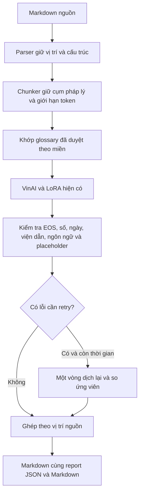

# Pipeline inference pháp lý VI→EN

## Mục lục

1. [Trạng thái và bằng chứng](#trạng-thái-và-bằng-chứng)
2. [Luồng xử lý](#luồng-xử-lý)
3. [Chạy trên Kaggle offline](#chạy-trên-kaggle-offline)
4. [Duyệt glossary](#duyệt-glossary)
5. [Chạy local và CLI](#chạy-local-và-cli)
6. [Chốt để dùng trong submission](#chốt-để-dùng-trong-submission)
7. [Giới hạn còn cần kiểm tra](#giới-hạn-còn-cần-kiểm-tra)

## Trạng thái và bằng chứng

Code thêm lớp inference quanh **adapter đã train**, dành cho VI→EN. EN→VI vẫn
dùng đường inference hiện có. Không train thêm, không sửa adapter, không lọc/chia
lại frozen dataset. Cấu hình decoding chính thức vẫn ở `submission/configs/vi2en.json`.

| Kiểm tra | Kết quả hiện có |
|---|---|
| Parse → serialize và khôi phục placeholder nguồn | 2.783/2.783 đoạn dev khớp từng byte |
| Token budget từ 27.756 train pairs | p90=254, p95=264; target=264, retry=132, hard=1.024 |
| Adapter thật + base offline trên CPU | Smoke có heading/list/CRLF chạy được, không fallback |
| Probe 10 mẫu cũ kết thúc `/ND` | A0: cả 10 có EOS trước cap; A1 tắt ngram3: không còn dấu hiệu cụt |
| Glossary | Bảng ứng viên từ train; tất cả pending, chưa tự áp dụng |
| Placeholder survival trên 200 dev units | Chưa đo được: dev không có markup dạng cặp |
| Full-dev A/B, R0–R5, Docker GPU và giới hạn thời gian | Cần chạy trên Kaggle/môi trường deployment |

Trong **10 mẫu cụt được chọn**, A0 có BLEU=21,0670 và chrF++=41,9001; chỉ đổi
`no_repeat_ngram_size=3 → 0` cho A1 đạt BLEU=57,2895, chrF++=72,9127.
Đây là mẫu lỗi được chọn có chủ đích, **không phải điểm toàn dev**. Kết quả cho
thấy việc cấm lặp ngram làm ảnh hưởng quá trình sinh trong các trường hợp này;
không chứng minh mọi lỗi thiếu nội dung đều có cùng nguyên nhân.

Baseline snapshot được tính lại với target nguyên văn trong frozen JSONL. Điểm
raw-text này có thể lệch nhẹ với metric lúc train vì metric train decode label
qua tokenizer. Mọi candidate mới trong cùng phép đánh giá dùng chung protocol.

Chi tiết khám phá repo và các giả định: [ASSUMPTIONS.md](ASSUMPTIONS.md).

## Luồng xử lý



Parser giữ marker, khoảng trắng, LF/CRLF, code, URL và offset. Model dịch nội
dung từng slot; ký hiệu Markdown mới do model tự sinh được escape để không tạo
heading, bullet hay cột bảng ngoài nguồn. Marker inline gốc được khôi phục qua
placeholder. Nếu mất URL hoặc không khôi phục an toàn được thì giữ nguyên unit
nguồn và ghi error; không đoán vị trí hoặc âm thầm mất nội dung.

Validator dùng chuẩn hóa số theo VI/EN, ngày `(ngày, tháng, năm)`, mã văn bản với
`Đ→D`, và multiset thực thể. Sai định dạng số mơ hồ được ghi warning. Các tín hiệu
ngắn, thiếu câu, sai ngôn ngữ là heuristic và cần người đọc xác nhận.

Retry có tối đa một vòng: `strip_spans`, `split_smaller`, `nbest_rerank`, hoặc
`anti_repeat` nếu đã có giá trị A/B. Giữ cả ứng viên đầu và retry. Theo SPEC,
retry chỉ thắng khi giảm penalty, sửa ít nhất một error và không tạo error mới;
warning-only glossary retry có thể được thử nhưng không thắng chỉ nhờ giảm warning.

Tất cả tham số inference nằm trong **`submission/configs/inference_pipeline.json`**.
`features.enabled=false` mặc định. Có cờ riêng cho parser, inline, chunker, decoding,
dynamic length, glossary, validator, retry và cache. Biến môi trường
`VINAI_PIPELINE_<FLAG>=0/1` có thể đổi cờ; thay đổi làm mất hiệu lực evidence cũ.

## Chạy trên Kaggle offline

### Bước 1 — Tạo ZIP trên local

```powershell
.venv\Scripts\python.exe scripts\package_inference_pipeline.py
```

Kết quả: `dist/NLP_inference_pipeline.zip` và SHA256 bên cạnh. ZIP gồm code,
notebook, bản copy nguyên trạng frozen dataset, config, tài nguyên glossary,
hai `best_model` và snapshot prediction. Không có optimizer/checkpoint train,
không có base weights lớn. Script không ghi vào dataset hoặc ZIP model nguồn.

### Bước 2 — Add Input trên Kaggle

1. `NLP_inference_pipeline.zip`.
2. Snapshot offline `vinai-translate-vi2en-v2` đã dùng train, revision
   `4eb2219d447d4352861e71e371a6b6abcb0509c8`.
3. Wheelhouse offline đã dùng train (`vinai-training-wheelhouse`).

Không cần LaBSE, không chạy builder/freeze, không tải base model mới. Notebook
dùng `HF_HUB_OFFLINE=1`, `TRANSFORMERS_OFFLINE=1` và `pip --no-index`.

### Bước 3 — Mở notebook 05

Upload `notebooks/05_inference_pipeline_kaggle.ipynb`, bật GPU, tắt Internet.
Chạy từ đầu: kiểm SHA256 → cài wheel → kiểm base revision → test parser/validator
→ cause probe → placeholder availability → decoding A/B.

Probe dùng config của run tạo snapshot để điều tra lỗi cũ. A/B dùng **config
service hiện hành** làm A0. Hai kết quả được tách rõ, không gộp metric.

### Bước 4 — Duyệt glossary và chạy R0–R5

Sau A/B, notebook có smoke hai records. Smoke không được dùng chốt submission.
Đặt `RUN_FULL_ABLATION=True` để chạy toàn bộ dev. Candidate R3–R5 cần
`selection.json` có cùng adapter/dev/code/calibration; selection từ smoke không
được dùng cho full ablation.

Mỗi lần chạy tạo thư mục timestamp riêng để không trộn kết quả. Nếu notebook
restart, xác định lại đúng `SELECTION` đã sinh. Code/config/calibration thay đổi
thì cần chạy lại A/B tương ứng.

### Bước 5 — Tải kết quả

Cell cuối tạo `NLP_inference_reports.zip`. Đọc:

- `decoding_ab.md`, `selection.json`.
- `ablation.md` và R0–R5 summary: BLEU, chrF++, signature, E1–E7, structure,
  coverage, retry và runtime.
- `manual_review.md`/`.json`: 30 mẫu ngẫu nhiên cố định.
- `selected_pipeline.json` và `promotion_evidence.json`: cấu hình đề xuất và
  các điều kiện còn pending.

Không dùng public/private test để chọn lại model, glossary hoặc decoding.

## Duyệt glossary

`submission/resources/glossary_candidates.csv` chứa bằng chứng từ train. Các
phân phối chỉ là co-occurrence giữa hai vế, có thể có nhiễu do header/cột bị gộp.
Kiểm nguồn và ví dụ, sửa `preferred`/`accepted_variants`, rồi chép những dòng đúng
vào **`glossary.csv`** và đặt `status=approved`. `accepted_variants` là JSON array.
Không approve cả bảng cùng lúc hoặc tự coi biến thể nhiều nhất là luôn đúng.

Khớp cụm dài nhất trước, theo ranh giới từ, direction và domain. Khi khớp `Bộ Y tế`
thì không dùng thêm `y tế` bên trong. Không thay toàn document, không chèn từ vào
cuối câu. Miền được chấm bằng keyword từ train và ngưỡng confidence/margin trong
config; khi không đủ chắc thì chỉ dùng glossary `general`.

Các miền hiện có lấy từ category frozen train. Miền ngoài corpus như medical
không tự được xác nhận bằng những keyword đó; cần người duyệt bổ sung tài nguyên
và kiểm trên dev phù hợp. Tên cơ quan có dấu giữ nguyên có thể thêm vào
`validator.kept_names` sau khi rà soát; sửa config cần đo lại A/B/ablation.

## Chạy local và CLI

CPU chỉ thích hợp smoke/probe nhỏ. Nạp đúng base offline:

```powershell
$env:HF_HUB_OFFLINE = "1"
$env:TRANSFORMERS_OFFLINE = "1"
$env:VINAI_VI2EN_MODEL_DIR = "D:\MyProject\NLP\offline_training_assets\models\vinai-translate-vi2en-v2"
.venv\Scripts\python.exe -m unittest discover -s tests -q
.venv\Scripts\python.exe scripts\check_inference_roundtrip.py
```

Giải nén adapter vào thư mục mới bằng `evaluation prepare --archive <model.zip>
--output <empty-folder>`. Sau đó `evaluation run --mode causes|ab|placeholder|ablation`
dùng `--dev`, `--adapter`, `--experiment-config`, `--pipeline-config`, `--output`;
cause/A/B thêm `--baseline-snapshot`, ablation thêm `--selection`. Xem `--help`.

Để dịch một tài liệu thử, tạo **bản copy** config với `features.enabled=true`,
`evaluation.experimental=true`, giữ `new_decoding=false` trước A/B:

```powershell
.venv\Scripts\python.exe -m src.vinai_baseline.document_cli `
  --config submission\configs\vi2en.json `
  --saved-model-dir <adapter-folder> `
  --pipeline-config <experimental-copy.json> `
  --input <input.md> --output <output.md> --allow-cpu
```

Sinh `output.md.report.json` và `.md`. Report chứa nội dung để rà soát; log JSON
chỉ ghi stage/thời gian/count, không in nội dung tài liệu. Cảnh báo thư viện rằng
`max_new_tokens` ưu tiên `max_length` không phải lỗi dừng; cap hiệu lực được ghi
trong provenance từng sequence.

## Chốt để dùng trong submission

Hiện chưa biết GPU/RAM/timeout của ban tổ chức; `time_budget_per_doc=null` và
pipeline vẫn **tắt** trong config giao hàng. Ghi giới hạn vào config trước phép đo
deployment. Budget được kiểm ở ranh giới stage, không thể dừng ngay một lần generate.
Khi gần budget, bỏ retry; khi lớp mới lỗi/vượt budget, quay về inference cũ và ghi report.

1. Chạy full R0–R5 với đúng model sẽ deploy. Nếu dùng merged weights, đo lại
   bằng chính thư mục merged đó; không dùng identity/hash của adapter thay thế.
2. Duyệt 30 mẫu trong `manual_review.json`, đổi từng `verdict` thành `approved`
   sau khi xác nhận ý nghĩa pháp lý. Duyệt glossary và duyệt bản dịch là hai việc riêng.
3. Chạy document smoke thực tế trên GPU deployment với candidate ở experimental
   mode. Giữ report gồm model identity, code/config hash, structure, coverage và device.
4. Chạy `scripts/finalize_inference_promotion.py --help`; truyền evaluation-dir,
   selected config, experiment config, model-dir, deployment-report và thư mục output
   rỗng. Script kiểm đủ dev, R0–R5, review, metric, worst-document runtime và hash.
   Khi bật inline placeholders, thêm `--placeholder-report` với kết quả survival
   của đúng candidate và đủ 200 markup units thật trên dev. Frozen JSONL hiện
   không có những units này: cần khôi phục tài liệu dev gốc nếu có, và thiết kế
   phép kiểm tương ứng trước khi có thể đáp ứng nghiệm thu SPEC. Không bịa mẫu
   hoặc đổi status để qua bước kiểm.
5. Sau khi passed, mount `approved_pipeline.json`, evidence và glossary; đặt
   `VINAI_PIPELINE_CONFIG`/`VINAI_PIPELINE_REPORT_DIR`. Cập nhật đường dẫn mount trong
   config nhưng giữ nội dung thuật toán/tài nguyên. Đường dẫn HTTP, plain Markdown
   response và `translate.sh input output endpoint` vẫn giữ nguyên.

Docker build context đã copy resources. Report mặc định ở `/app/reports`; có thể
mount thư mục riêng. Sửa cấu hình/model/code/glossary sau khi chốt sẽ làm evidence
không còn khớp; service dùng fallback và ghi lý do. Không chỉnh config official để
vượt qua gate hoặc đổi status report thủ công.

## Giới hạn còn cần kiểm tra

- Chưa có GPU tại local và Docker daemon chưa hoạt động, nên chưa build/run image.
- Frozen dev là segment JSONL. Điểm theo document được ghép theo `chunk_index`
  với separator tổng hợp; không khôi phục được layout Markdown gốc của tài liệu.
- Placeholder `brackets` là lựa chọn provisional; không có 200 markup dev units
  để tuyên bố format tối ưu hoặc chốt pipeline với inline placeholders. Các ca
  Markdown khó có test riêng và source fallback.
- Short table cells mặc định dịch riêng. Có strategy `lookup` cho entry đã duyệt
  và `column_context` có kiểm separator/fallback; cần so sánh trên mẫu bảng thật
  trước khi đổi strategy chính thức.
- `anti_repeat` chưa có giá trị A/B nên tắt. Constrained search trong transformers
  5.x cần custom generation; pipeline offline hiện ghi skipped, dùng n-best chính.
  Dịch ngược P2 chưa triển khai và không cho bật nhầm.
- Các check là tín hiệu. Ví dụ smoke dịch đúng số `100` nhưng lựa chọn từ `men`
  thay vì `people` có thể vẫn không phù hợp; việc này cần rà soát ý nghĩa.
